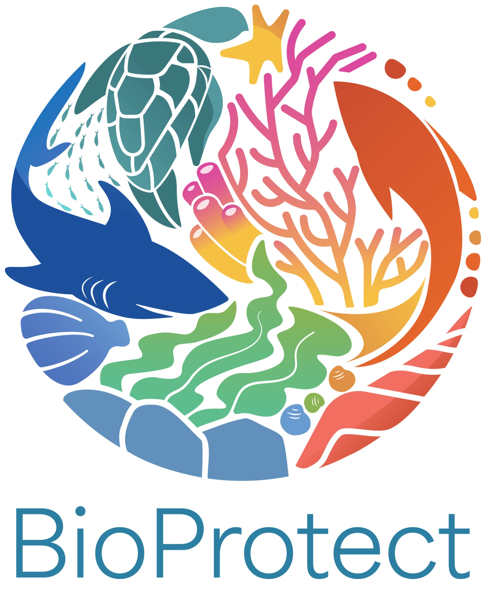

<div align="center">


# third-eye-client

**Cross-platform desktop client for Chasing underwater ROVs**

Built with Rust 🦀 and [Slint](https://slint.dev/) — native GUI on macOS, Windows and Linux.

[](https://codecov.io/gh/marshalling-ltd/third-eye-client)
[](https://github.com/marshalling-ltd/third-eye-client/actions/workflows/ci.yml)
[](https://github.com/marshalling-ltd/third-eye-client/actions/workflows/release.yml)


</div>


**📖 Documentation: <https://marshalling-ltd.github.io/third-eye-client/>**

It shows the live camera from the ROV, lets you take photos and videos, and puts your position on a map from a GPS at the surface.

## 🌊 Why this exists: BioProtect



third-eye-client is a helper for [BioProtect](https://bioprotect-project.eu/about/), a Horizon Europe project under the EU Mission Ocean and Waters. BioProtect develops ecosystem-based tools to speed up the protection and restoration of marine biodiversity in European seas, and looking at what is on the seabed is part of that work.

The idea behind this repository is to bring **ROVs of any make into one public project and make them work for free, all the time**. The app is open source (GPL-3.0), so anyone monitoring the sea can use it, and anyone can add support for another ROV.

It has been used in BioProtect's [Croatian associated region](https://bioprotect-project.eu/associated-regions/croatia-2/) (Lumbarda, on the island of Korčula). More on the [why](https://marshalling-ltd.github.io/third-eye-client/explanation/why-this-project/) and on [supported ROVs](https://marshalling-ltd.github.io/third-eye-client/reference/supported-rovs/) is in the docs.

### Supported ROVs

| ROV | Status |
|---|---|
| **Chasing M2S** | Supported. Tested with a real ROV on macOS; Linux and Windows are tested against the simulator only so far. |
| Other Chasing models and firmware | Expected to work, not verified. |
| Other makes | Wanted. [Open an issue](https://github.com/marshalling-ltd/third-eye-client/issues/new) with your ROV's documentation and we will support it; we build a simulator for it first. See [how](https://marshalling-ltd.github.io/third-eye-client/reference/supported-rovs/#request-support-for-your-rov). |

For development without hardware there is a [`chasing-simulator`](https://marshalling-ltd.github.io/third-eye-client/development/simulator/) that stands in for a Chasing ROV (telemetry, video, camera API). It is not a real ROV, so it cannot prove everything works on one.

| | Where to look |
|---|---|
| 🧭 **Using the app** | [Install](https://marshalling-ltd.github.io/third-eye-client/guide/install/), [connect to the ROV](https://marshalling-ltd.github.io/third-eye-client/guide/connect/), [GPS](https://marshalling-ltd.github.io/third-eye-client/guide/gps/), [troubleshooting](https://marshalling-ltd.github.io/third-eye-client/guide/troubleshooting/) |
| 🧱 **Reference** | [Supported ROVs](https://marshalling-ltd.github.io/third-eye-client/reference/supported-rovs/), [features](https://marshalling-ltd.github.io/third-eye-client/reference/features/), [architecture](https://marshalling-ltd.github.io/third-eye-client/reference/architecture/) |
| 💡 **Explanation** | [Why this project exists](https://marshalling-ltd.github.io/third-eye-client/explanation/why-this-project/), [how the app finds the ROV](https://marshalling-ltd.github.io/third-eye-client/explanation/finding-the-rov/), [how position gets onto the map](https://marshalling-ltd.github.io/third-eye-client/explanation/gps-and-position/), [working offline](https://marshalling-ltd.github.io/third-eye-client/explanation/offline-and-storage/) |
| 🛠️ **Development** | [Contributing](https://marshalling-ltd.github.io/third-eye-client/development/contributing/), [building and testing](https://marshalling-ltd.github.io/third-eye-client/development/building/), [ROV simulator](https://marshalling-ltd.github.io/third-eye-client/development/simulator/), [release process](https://marshalling-ltd.github.io/third-eye-client/development/release/) |

## 📥 Installing

Download the installer for your platform from the [Releases page](https://github.com/marshalling-ltd/third-eye-client/releases): `.dmg` (macOS), NSIS installer (Windows) or `.AppImage` (Linux).

## 🤝 Contributing

Contributions are welcome. In short:

1. **Fork** this repository on GitHub, clone your fork and add this repository as `upstream`:

   ```sh
   git clone git@github.com:<your-user>/third-eye-client.git
   cd third-eye-client
   git remote add upstream git@github.com:marshalling-ltd/third-eye-client.git
   ```

2. **Install the tools** and check that it works (Linux needs a few system packages, see the docs):

   ```sh
   make requirements   # one-time tool setup (Rust nightly and cargo tools)
   cargo run           # start the app
   make check          # fmt, clippy, audit, deny, typos and the full test run
   ```

3. **Branch** off `upstream/master`, make a focused change with tests, run `make check`, push to your fork and **open a pull request** against `master`.

The full guide, with prerequisites, commit style, the ROV simulator for working without hardware, and the release process, is in the [Contributing](https://marshalling-ltd.github.io/third-eye-client/development/contributing/) section of the docs.

## 📝 Documentation source

The docs live in [`docs/`](docs/) and are built with [MkDocs Material](https://squidfunnel.github.io/mkdocs-material/) and published to GitHub Pages by the [`Docs` workflow](.github/workflows/docs.yml) on every push to `master` that touches them. To preview locally:

```sh
uv run --with-requirements docs/requirements.txt mkdocs serve
```

## 📄 License

Copyright (c) 2024-2026 Marshalling Ltd. Licensed under the [GNU General Public License v3.0 only](LICENSE) (`GPL-3.0-only`).
