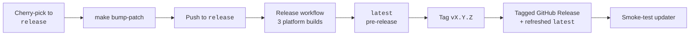

# Release process



1. Merge or cherry-pick only release-ready commits into the `release` branch.
2. Bump the app version (patch bump helper): `make bump-patch`
3. Commit and push the version bump to `release`.
4. Wait for the `Release` workflow to finish all three platform builds on `release`. This run refreshes the rolling `latest` **pre-release** with all three installers.
5. Verify the `latest` pre-release assets (macOS DMG, Windows installer, Linux AppImage).
6. Create and push a semantic version tag that **matches `Cargo.toml` exactly**:

   ```sh
   git tag vX.Y.Z
   git push origin vX.Y.Z
   ```

7. Confirm the `publish` job creates:
   - the tagged GitHub Release (`vX.Y.Z`) with all three artifacts, and
   - the refreshed `latest` prerelease mirror with the same artifacts.
8. Smoke-test the updater flow in the app:
   - Restart the app (or click **Check for updates** in Profile → Application updates).
   - Confirm it detects the new tag and opens the correct platform download when **Download update** is clicked.

!!! warning
    The `publish` job fails if the pushed tag does not match the version in `Cargo.toml`.
