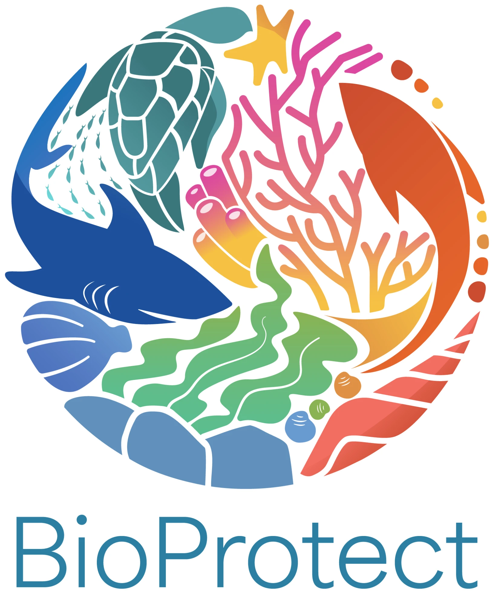

# Why this project exists

{ width="160" align="right" }

third-eye-client is a helper for [BioProtect](https://bioprotect-project.eu/about/), a Horizon Europe project under the EU Mission Ocean and Waters. Looking at what is on the seabed is part of protecting it, and an ROV is one way to do that.

## BioProtect in short

BioProtect develops and demonstrates ecosystem-based solutions that speed up the protection and restoration of biodiversity in European seas, in line with the EU's 2030 targets. It builds a decision-support framework for managing marine areas. That covers engaging stakeholders, monitoring and predicting changes in marine biodiversity, mapping human pressures, choosing which areas to protect or restore, and measuring the ecological and social effects. The methods are tested at five sites in the Atlantic, and the project also works with associated regions elsewhere.

## The idea behind this app

Bring **ROVs of any make into one public project and make them work for free, all the time.** The app is open source (GPL-3.0), so anyone who monitors the sea can use it, and anyone can add support for another ROV. See [Supported ROVs](../reference/supported-rovs.md) for what works today and what a new ROV needs.

The app does three things for that work:

- shows the **live camera** from the ROV,
- lets you **take photos and videos** and keeps them with the depth, heading and position they were taken at,
- puts your position on a **map**, from a GPS at the surface, because the ROV cannot see satellites underwater. See [how position gets onto the map](gps-and-position.md).

It keeps working **without internet**, which matters on a boat. See [working offline](offline-and-storage.md).

## Where it has been used

It has been used in BioProtect's [Croatian associated region](https://bioprotect-project.eu/associated-regions/croatia-2/), at Lumbarda on the island of Korčula. That region is a small coastal municipality with seagrass meadows, rocky reefs and ancient quarry sites. Its listed challenges include seasonal tourism pressure, anchor damage, invasive species, and the lack of a complete habitat map or standard monitoring.

## Status

The app has been tested with a real ROV on macOS only. Linux and Windows are tested against the built-in simulator, not yet with a real ROV. The only ROV supported so far is the Chasing M2S.

## Take part

Contributions are welcome, especially support for other ROVs and reports from real dives. If you have a ROV that is not supported, [open an issue](../reference/supported-rovs.md#request-support-for-your-rov) with its documentation and we will support it. Start with [Contributing](../development/contributing.md), or open an [issue](https://github.com/marshalling-ltd/third-eye-client/issues).
