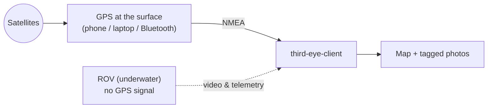

# GPS on the map

!!! important
    This is the whole point of the project, so read it slowly.

## The problem

GPS works using **radio signals from satellites**. Radio signals **cannot travel through water**. The moment the ROV goes underwater, it is blind to GPS and has no idea where it is on the map.

## The fix: get GPS from the surface

The position comes from something that **stays at the surface**, in the open air where it can see satellites, and is handed to the app. The app uses it to centre the map and to tag your photos.

**NMEA** is the standard language that GPS devices speak to report their position. The app can listen to it from several places, so you can use whatever you have. It accepts both NMEA and TAIP lines whichever protocol is selected (the selection only sets which is tried first), and it never sends commands to the receiver.

!!! tip
    Leave **GPS protocol** on **NMEA** unless your device specifically needs **TAIP**.

## Your options (pick one)

### 1. Your laptop's own GPS

The simplest, if it has one.

| OS | What is used |
|---|---|
| macOS | Native CoreLocation (non-blocking; asks permission once on first launch) |
| Windows | Windows Location Services (background thread with a 30 s timeout) |

Keep the laptop at the surface, near a window or outdoors, for a good fix.

### 2. Your phone as a GPS

The most common. Install a free GPS app on your phone and keep the phone at the surface (for example in a dry bag on the boat). Then open **Phone GPS** from the menu at the top right and choose a **Connection mode**:

| Connection mode | How it works | Works with |
|---|---|---|
| **TCP Listen** | The app *waits* and your phone app *connects to the laptop*. The app shows the address and port to type into the phone app. | GPS2IP, GPSd Forwarder, ShareGPS |
| **Connect to TCP Server** (TCP Client) | The opposite: your phone app runs a server and the app *dials into it*. You type the phone's IP address and port into the app. | ShareGPS, GPS Tether Server |
| **Bluetooth** (Serial / Bluetooth) | Pair a Bluetooth GPS device, or a phone GPS app that offers Bluetooth, with your laptop first, in your computer's own Bluetooth settings. It then appears in the list, as `bt://<address> <name>` on Mac and Linux. Pick it and press **Start GPS**. A USB GPS receiver is listed here too, under **Detected serial ports (Bluetooth/USB)**. If your port is not listed, type it into **Manual serial-port override**. | Bluetooth GPS receivers, USB GPS receivers, phone apps exposing an SPP channel |

Serial ports are listed as `COM*`, `/dev/cu.usbmodem*`, `/dev/ttyACM*` or `/dev/ttyUSB*`. In **TCP Listen** mode the app listens on a port (default `11123`) that you enter in the phone app; in **Connect to TCP Server** mode you enter the **Phone server IP address** and **Phone server port**. A position that stops updating is treated as stale after a timeout (default 10 s).

## Bluetooth and USB setup per OS

| Platform | Bluetooth GPS | USB GPS |
|---|---|---|
| **macOS** | Pair it once in System Settings → Bluetooth. It then appears in the list as `bt://…`; the app opens the connection itself, so there is no need to click *Connect* in System Settings. The first use asks for Bluetooth permission. | Shows up as `/dev/cu.usbmodem*`; no setup. |
| **Linux** | Pair it once in the desktop's Bluetooth settings (BlueZ / `bluetoothd` must be running). It appears as `bt://…`; no `rfcomm bind` is needed. | `/dev/ttyACM*` / `/dev/ttyUSB*` belong to the `dialout` group. Add yourself once with `sudo usermod -aG dialout $USER`, then **log out and back in**; without it the port fails with *Permission denied*. |
| **Windows** | Pair it in Settings → Bluetooth; the app lists the *Outgoing* COM port. | Shows up as a `COM*` port. |

## Good to know

- New paired or plugged-in devices appear in the list within a few seconds while the Bluetooth GPS screen is open and GPS is stopped.
- Many receivers expose several USB serial ports and only one carries the position data. If a port connects but never reports a fix, try the others. The app says so after about 10 seconds if a port sends nothing, or sends data that is not GPS sentences.
- A USB GPS receiver is a good fallback when a Bluetooth receiver's battery is low.
- **Mac + Geoastra X8-M1** (USB ID `19d1:0001`): use it over **Bluetooth**. Its position port stays silent under macOS's built-in USB serial driver (it works on Linux), so the app hides its USB ports on a Mac.
- A Bluetooth receiver talks to one computer at a time: disconnect it from other machines, or switch off their Bluetooth, before connecting.
- Satellite reception is separate from the connection: a receiver indoors can be connected and still report no fix.

## How to know it is working

On the **Device Map** screen, look at the small **NMEA** badge (bottom-left):

| Badge | Meaning |
|---|---|
| **OK** (green) | You have a position |
| `..` (amber) | GPS is running but there is no position yet |
| `--` (red) | GPS is off |

Tapping the badge opens the **Phone GPS** screen, so it is also the quickest place to start fixing a problem.

When you have a fix, the map recentres on your position and new photos get tagged with it.
