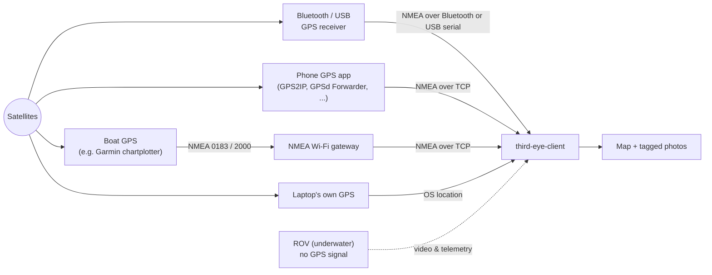

# GPS on the map

## The problem

GPS works using **radio signals from satellites**. Radio signals **cannot travel through water**. The moment the ROV goes underwater, it is blind to GPS and has no idea where it is on the map.

## The fix: get GPS from the surface

The position comes from something that **stays at the surface**, in the open air where it can see satellites, and is handed to the app. The app uses it to centre the map and to tag your photos.

**NMEA** is the standard language that GPS devices speak to report their position. The app can listen to it from several places, so you can use whatever you have. It accepts both NMEA and TAIP lines whichever protocol is selected (the selection only sets which is tried first), and it never sends commands to the receiver.

!!! tip
    Leave **GPS protocol** on **NMEA** unless your device specifically needs **TAIP**.

## Your options (pick one)

The main sources are a **Bluetooth** or **USB** GPS receiver. The **TCP** modes cover phone GPS apps and boat networks. All of them feed the same position to the app.

### 1. Your laptop's own GPS

The simplest, if it has one.

| OS | What is used |
|---|---|
| macOS | Native CoreLocation (non-blocking; asks permission once on first launch) |
| Windows | Windows Location Services (background thread with a 30 s timeout) |

Keep the laptop at the surface, near a window or outdoors, for a good fix.

### 2. Your phone as a GPS

The most common. Install a free GPS app on your phone and keep the phone at the surface (for example in a dry bag on the boat). Then open **GPS** from the menu at the top right and choose a **Connection mode**:

| Connection mode | How it works | Works with |
|---|---|---|
| **TCP Listen** | The app *waits* and your phone app *connects to the laptop*. The app shows the address and port to type into the phone app. | GPS2IP, GPSd Forwarder, ShareGPS |
| **Connect to TCP Server** (TCP Client) | The opposite: your phone app runs a server and the app *dials into it*. You type the phone's IP address and port into the app. | ShareGPS, GPS Tether Server |
| **Bluetooth** (Serial / Bluetooth) | Pair a Bluetooth GPS device, or a phone GPS app that offers Bluetooth, with your laptop first, in your computer's own Bluetooth settings. It then appears in the list, as `bt://<address> <name>` on Mac and Linux. Pick it and press **Start GPS**. A USB GPS receiver is listed here too, under **Detected serial ports (Bluetooth/USB)**. If your port is not listed, type it into **Manual serial-port override**. | Bluetooth GPS receivers, USB GPS receivers, phone apps exposing an SPP channel |

Serial ports are listed as `COM*`, `/dev/cu.usbmodem*`, `/dev/ttyACM*` or `/dev/ttyUSB*`. In **TCP Listen** mode the app listens on a port (default `11123`) that you enter in the phone app; in **Connect to TCP Server** mode you enter the **Phone server IP address** and **Phone server port**. A position that stops updating is treated as stale after a timeout (default 10 s).

### 3. A boat's instruments over TCP (for example Garmin)

If the boat already has a GPS, such as a chartplotter, use it. The app reads the position from a TCP connection, so the instrument or a gateway on the boat network has to offer one.

- **Garmin chartplotters** normally send **NMEA 0183 over a serial (wired) port** and **NMEA 2000** over the boat's data bus. They do not normally offer NMEA over Wi-Fi or Ethernet themselves. A few Garmin devices do: for example the Garmin Signal VHF radio broadcasts NMEA 0183 over Wi-Fi. Check your model's manual under its NMEA or communications settings.
- **The usual route** is a small **NMEA gateway** (for example Yacht Devices or Quark-elec) that connects to the boat's NMEA 0183 or NMEA 2000 network and serves it over Wi-Fi as TCP. Connect your laptop to the gateway's Wi-Fi.
- In the app, open **GPS**, choose **Connect to TCP Server**, and enter the gateway's IP address and port from its manual. The field labels say "phone", but any TCP server that sends NMEA works. If the instrument instead wants to *connect to* the laptop, use **TCP Listen** and enter the laptop's address and port in the instrument.
- The app reads the **GGA** and **RMC** sentences from any talker (`GP`, `GN` and so on) and ignores everything else, so a gateway that sends many sentence types is fine.

!!! note
    This has not been tested with a Garmin device or a gateway. It uses the same TCP code as the phone apps, so it is expected to work, but reports are welcome as [issues](https://github.com/marshalling-ltd/third-eye-client/issues).

## Bluetooth and USB setup per OS

Bluetooth and USB support is generic: it works with any GPS receiver that sends NMEA over a Bluetooth serial (SPP) channel or a USB serial port, and nothing in the app is specific to one make. So far it has been tested on hardware with a single receiver, the Geoastra X8-M1 (over USB its position port is silent on macOS, so use it over Bluetooth there), so other receivers are expected to work but have not been verified. Reports of what works and what does not are welcome as [issues](https://github.com/marshalling-ltd/third-eye-client/issues).

| Platform | Bluetooth GPS | USB GPS |
|---|---|---|
| **macOS** | Pair it once in System Settings → Bluetooth. It then appears in the list as `bt://…`; the app opens the connection itself, so there is no need to click *Connect* in System Settings. The first use asks for Bluetooth permission. | Shows up as `/dev/cu.usbmodem*`; no setup. |
| **Linux** | Pair it once in the desktop's Bluetooth settings (BlueZ / `bluetoothd` must be running). It appears as `bt://…`; no `rfcomm bind` is needed. | `/dev/ttyACM*` / `/dev/ttyUSB*` belong to the `dialout` group. Add yourself once with `sudo usermod -aG dialout $USER`, then **log out and back in**; without it the port fails with *Permission denied*. |
| **Windows** | Pair it in Settings → Bluetooth; the app lists the *Outgoing* COM port. | Shows up as a `COM*` port. |

## Good to know

- New paired or plugged-in devices appear in the list within a few seconds while the Bluetooth GPS screen is open and GPS is stopped.
- Many receivers expose several USB serial ports and only one carries the position data. If a port connects but never reports a fix, try the others. The app says so after about 10 seconds if a port sends nothing, or sends data that is not GPS sentences.
- A USB GPS receiver is a good fallback when a Bluetooth receiver's battery is low.
- A Bluetooth receiver talks to one computer at a time: disconnect it from other machines, or switch off their Bluetooth, before connecting.
- Satellite reception is separate from the connection: a receiver indoors can be connected and still report no fix.

## How to know it is working

On the **Map** screen, look at the small **GPS** badge (bottom-left):

| Badge | Meaning |
|---|---|
| **OK** (green) | You have a position |
| `..` (amber) | GPS is running but there is no position yet |
| `--` (red) | GPS is off |

Tapping the badge opens the **GPS** screen, so it is also the quickest place to start fixing a problem.

When you have a fix, the map recentres on your position and new photos get tagged with it.
