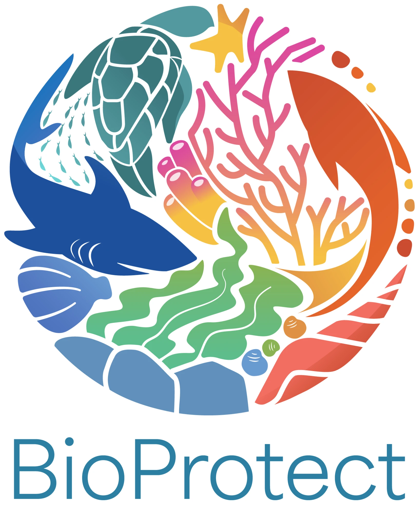

# third-eye-client

**Cross-platform desktop client for underwater ROVs.**

Built with Rust and [Slint](https://slint.dev/), as a native app on macOS, Windows and Linux.

Chasing ROVs are supported today, and the goal is to support ROVs of any make. See [Supported ROVs](reference/supported-rovs.md).

It shows the **live camera** from the ROV, lets you **take photos and videos**, and puts your position on a **map**, even though the ROV itself is underwater and cannot see GPS satellites.

-   **See**

    Live camera with depth, heading and battery on top.

-   **Capture**

    Photos and videos, each tagged with where you were.

-   **Locate**

    Your position on a map, from a GPS at the surface.

{ width="120" align="right" }

Built as a helper for [BioProtect](https://bioprotect-project.eu/about/), with the goal of making ROVs of any make work for free. See [why this project exists](explanation/why-this-project.md).

## Where to start

!!! tip "New here?"
    Follow the **Using the app** pages in order. You do not need to understand the code.

1. [Install the app](guide/install.md)
2. [Connect to the ROV](guide/connect.md) over Wi-Fi or a USB-to-Ethernet cable
3. [Watch video and take photos](guide/video-and-capture.md)
4. [Get GPS on the map](guide/gps.md)
5. If something is broken: [Troubleshooting](guide/troubleshooting.md)

## Understanding how it works

- [How the app finds the ROV](explanation/finding-the-rov.md)
- [How position gets onto the map](explanation/gps-and-position.md)
- [Working offline](explanation/offline-and-storage.md)

## For developers

- [Contributing](development/contributing.md)
- [Features](reference/features.md) and [architecture](reference/architecture.md)
- [Building and testing](development/building.md), the [ROV simulator](development/simulator.md) and the [release process](development/release.md)
- [Release notes](release-notes.md)

Source code and issues: [marshalling-ltd/third-eye-client](https://github.com/marshalling-ltd/third-eye-client).
