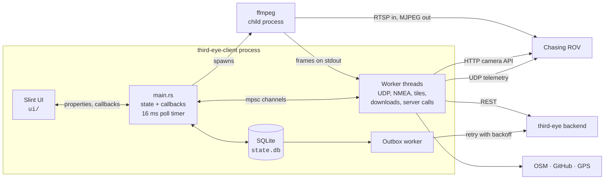
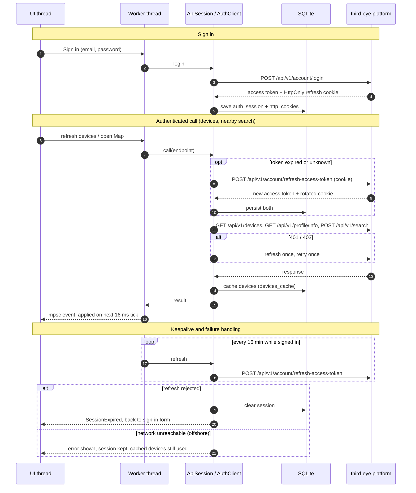

# Architecture

A native desktop app: one Rust binary with a [Slint](https://slint.dev/) UI, no embedded server. It talks to three kinds of peers — the ROV on the local link, the
[third-eye](https://github.com/marshalling-ltd/third-eye-platform) backend, and a few public services — and keeps everything it needs offline in a single SQLite file.

| Peer | Protocol | Used for |
|---|---|---|
| **ROV** (`192.168.1.88`) | UDP `8500`, RTSP `8554`, HTTP `80` | Telemetry, live video, capture and media files |
| **third-eye backend** (`https://third-eye.marshalling.eu`) | HTTPS REST | Sign-in, devices, nearby AOI / POI search |
| **GPS source** | CoreLocation, Windows Location, NMEA over TCP / serial | Device position |
| **OpenStreetMap, GitHub, IP geolocation** | HTTPS | Map tiles, update check, Linux location fallback |

**Threading model.** Slint is single-threaded, so all UI state lives in one `ThirdEyeState` on the main thread. Anything slow (UDP receive, NMEA, tile fetches, media
downloads, server calls, the ffmpeg pipe) runs on its own thread and reports back over an `mpsc` channel. A 16 ms Slint timer drains those channels and pushes the results
into the UI.

**Live video.** ffmpeg is launched as a child process that pulls RTSP over TCP and writes MJPEG frames to stdout (probing is capped by `RTSP_INPUT_ARGS` so the first frame is not held back by ffmpeg's default analysis time); a reader thread splits the stream into JPEGs and hands them
to the UI. Because ffmpeg can't bind to a network interface itself, it connects to an in-process forwarder that pins the connection to the ROV's interface (see [ROV network interface binding](../explanation/finding-the-rov.md)).

**Server session.** Every backend call goes through `ApiSession`, which refreshes the access token from the persisted refresh cookie before it expires, and once more on a
401/403. Only a rejected refresh signs the user out; transport failures don't, so the app stays usable offshore without internet.

**Talking to the platform.** Everything below goes through `ApiSession`; the UI thread never blocks on the network.

| Area | Endpoints | Notes |
|---|---|---|
| Account | `POST /api/v1/account/login`, `POST /api/v1/account/refresh-access-token`, `GET /api/v1/account/logout` | Refresh token lives only in the `HttpOnly` cookie |
| Devices | `GET` / `POST /api/v1/devices`, `GET` / `PATCH` / `DELETE /api/v1/devices/{id}`, `GET /api/v1/profile/info` | Typed client from `generated/`; edits are optimistic-locked via `concurrency` |
| Nearby | `POST /api/v1/search` (`aoi`, `poi`, `intermagnet_analysis`) | Hand-written client; re-fetched while the Map is open |

The `rest_outbox` table and its retry worker are in place for writes that must survive a crash or restart, but no feature enqueues into it yet.

**Storage.** One SQLite database in the OS data directory (WAL mode, embedded migrations) holds:

| Table | Contents |
|---|---|
| `settings` | Configuration key/value pairs |
| `auth_session`, `http_cookies` | Signed-in user and the persistent cookie jar |
| `devices_cache` | Last known devices, for offline use |
| `media_sync`, `capture_metadata` | Mirror of the ROV file list, download state, per-capture telemetry |
| `map_tile_cache` | OSM tiles as PNG blobs, evicted least-recently-used |
| `user_status_events` | Per-media status events, kept for upload to the server |
| `rest_outbox` | Durable queue of server writes, replayed with exponential backoff (max 5 min) |

Project layout:

| Path | Contents |
|---|---|
| `src/main.rs` | App entry point: state, UI bindings, callbacks, stream pipeline, ROV link setup |
| `src/camera.rs` | ROV camera HTTP client (capture, lamp, media list / download / delete) |
| `src/rov_status.rs` | UDP status receiver and packet decoding |
| `src/nmea.rs` | NMEA-0183 GPS over TCP listen, TCP client and serial / Bluetooth |
| `src/bt_port.rs` | Naming of Bluetooth GPS devices as `bt://<address> <name>` ports |
| `src/bluez.rs` | Linux Bluetooth link: brings the device up through BlueZ, finds its serial channel over SDP, opens it as an RFCOMM socket |
| `src/iobt.rs` | macOS Bluetooth link: runs IOBluetooth in a helper process (`--bluetooth-helper`) because it only opens channels from a process's main thread |
| `src/map.rs` | Slippy-map viewport, tile loading, native location (CoreLocation / Windows) |
| `src/network.rs` | ROV interface detection and recalibration |
| `src/ip_location.rs`, `src/update_check.rs`, `src/formatting.rs` | IP geolocation fallback, release-version selection, display helpers |
| `src/storage/` | `AppStore` facade: config, auth, API session, devices, media, search, tile cache, outbox, migrations |
| `src/simulator/`, `src/bin/` | ROV simulator and test UDP server (feature `test-tools`) |
| `ui/` | Slint UI: `app.slint` window, `shell/` top bar, `pages/` stream, map, media, devices, profile |
| `generated/` | Backend API client generated from the OpenAPI spec (`make open-api`) |
| `specs/`, `tests/` | Feature specs and integration tests |
| `scripts/`, `installer/`, `macos/` | Per-platform packaging |
